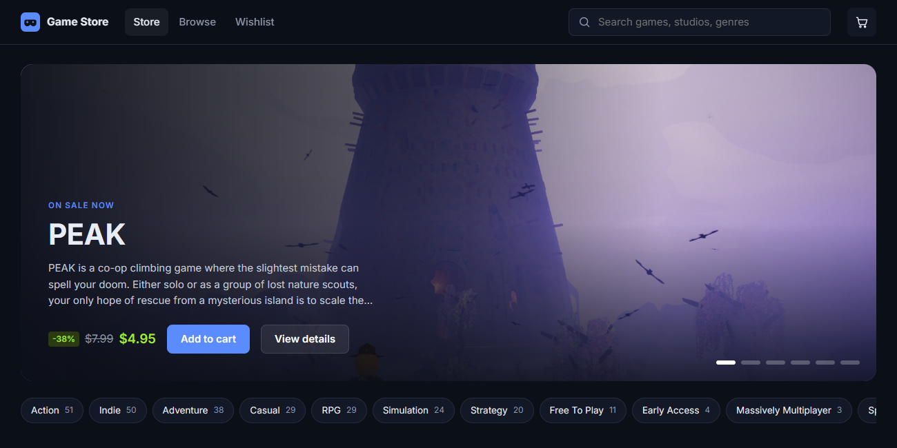

### Hi, I'm Byo

Software developer based in Vietnam. I build whatever the job needs: web apps, mobile apps, desktop tools,
and the small scripts and pipelines that hold them together. I'm happy on the frontend, the backend or deep in
Windows APIs, and I care most about software that's quick, clear and easy to live with.

**What I work with**

- **Web:** React, Next.js, TypeScript, Node.js, Vite, PixiJS
- **Mobile:** Flutter, Dart, Firebase
- **Desktop:** C#, .NET, Win32
- **Tooling:** Python, GitHub Actions, Playwright, Git

 

### [Agent Office](https://github.com/byocao/agent-office)

Your Claude Code sessions as characters on a side-view pixel stage. Each one types while it works, hops when it
needs you and goes off for a coffee when it's done. Click a character to see what its AI is doing and write back to it,
from your desk or your phone.

Next.js · React · PixiJS · Live2D · Node.js · TypeScript

 

<table>
<tr>
<td width="50%" valign="top">

**[Game Store](https://github.com/byocao/game-store)** · [live demo](https://byocao.github.io/game-store/)

A game shop running on live Steam Store data, rebuilt every morning by a GitHub Action.

React · TypeScript · Vite · GitHub Actions

</td>
<td width="50%" valign="top">

**[MiniStats](https://github.com/byocao/mini-stats)** · [download](https://github.com/byocao/mini-stats/releases/latest)

A tiny always-on-top FPS, CPU, RAM and GPU overlay for Windows. One ~180 KB exe, no installer.

C# · .NET · Win32

</td>
</tr>
</table>

Also: [shoesapp](https://github.com/byocao/shoesapp), a shoe shop app in Flutter with sign-in, search, saved items
and a cart on Firebase.

Most of my day-to-day work lives in private repos, so this is only part of it. If you want to work together or
something I made is broken, open an issue or reach out. English or Vietnamese is fine.
